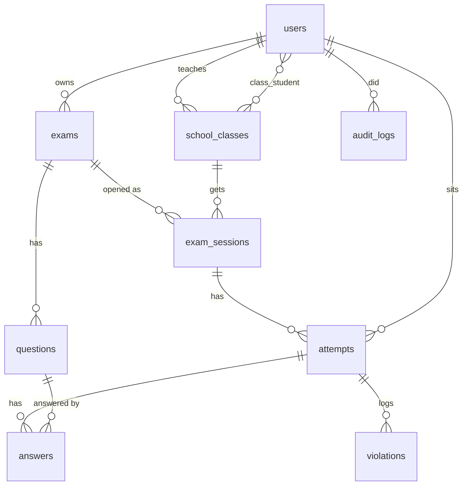

# LL Online Assessments

An online exam module for Limitless Learning: a Laravel API (`backend/`) and a Next.js app (`frontend/`).

## Run it

You need PHP 8.2+, Composer, and Node 20+ with npm. Use two terminals.

**Terminal 1: the API**

```bash
cd backend
composer install
cp .env.example .env          # Windows: copy .env.example .env
php artisan key:generate
touch database/database.sqlite   # Windows: type nul > database\database.sqlite
php artisan migrate --seed
php artisan serve
```

The API runs at http://localhost:8000.

**Terminal 2: the app**

```bash
cd frontend
cp .env.example .env.local    # Windows: copy .env.example .env.local
npm install
npm run dev
```

Open http://localhost:3000 (use `localhost`, not `127.0.0.1`, so sign-in cookies work).

## Sign in

Every account uses the password `password`.

| Role | Email |
|---|---|
| Teacher | aishath@ll.test |
| Student | ibrahim@ll.test (also hawwa@, mariyam@, ahmed@) |
| Admin | admin@ll.test |

## Optional

- **More data:** `php artisan migrate:fresh --seed --seeder=DemoSeeder` adds an open exam, a released result and a
  submission waiting to be marked. `--seeder=StressSeeder` adds a large school for trying lists and paging.
- **Hand in timed-out exams:** run `php artisan schedule:work` in a third terminal. It hands in any exam whose time has
  run out, even if the student never came back.
- **API reference:** http://localhost:8000/docs/api (while the API is running).
- **Tests:** `cd backend && php artisan test`

## Database

SQLite in development (the migrations also work on MySQL). The tables and how they connect:



| Table | What it holds | Key columns |
|---|---|---|
| `users` | Students, teachers and admins | `name`, `email`, `password`, `role` (admin, tutor, student), `is_active` |
| `school_classes` | A class for one subject | `name`, `subject_code`, `grade`, `tutor_id` |
| `class_student` | Which students are in which class | `school_class_id`, `student_id`, `subject_code`. Unique on `(student_id, subject_code)`: one class per subject |
| `exams` | An exam and its settings | `owner_id`, `title`, `time_limit_minutes`, `question_order` (in_order, random), `rules`, `status` (draft, published) |
| `questions` | The questions of an exam | `exam_id`, `position`, `kind` (mcq, true_false, fill_blank, written), `prompt`, `points`, `options`, `answer_key`, `approved`. Unique on `(exam_id, position)` |
| `exam_sessions` | An exam opened for one class | `exam_id`, `school_class_id`, `status` (not_open, open, closed), `opened_at`, `closed_at`, `results_released_at`. Unique on `(exam_id, school_class_id)` |
| `attempts` | One student sitting one session | `exam_session_id`, `student_id`, `started_at`, `deadline_at`, `submitted_at`, `submit_reason`, `status` (in_progress, submitted, marked), `violation_count`, `total_score`, `overall_comment`. Unique on `(exam_session_id, student_id)` |
| `answers` | A student's answer to one question | `attempt_id`, `question_id`, `response`, `flagged`, `awarded_marks`, `feedback`, `marking_ticks`, `client_saved_at`. Unique on `(attempt_id, question_id)` |
| `violations` | Each time a student left the exam window | `attempt_id`, `kind` (hidden, blur), `occurred_at` |
| `audit_logs` | Who published, opened, closed, released, marked or changed a user | `actor_id`, `action`, `subject_type`, `subject_id`, `meta` |

Laravel also adds `personal_access_tokens`, `sessions`, `cache` and `jobs`.

## Decisions made

- Rely on server clock to make it so students can't cheat by altering data client side 
- Used SQLite so you don't have to do much work to set it up
- 5 second grace period after exam timer is up to account for internet problems / delays throughout exam
- Tutors can't delete exams after publishing (only deletable at draft stage)
- Server side filtering/paginating for scaling
- A student can be in several classes but only one per subject.
- Admins can look at exams and submissions but not change them.

## Potential future stuff

- Setup MCP server so tutors can easily set up exams
- Maybe keep questions categorized and independant from exams, so they can be reused later
- Usedful analytics for tutors/students to identify weak points
- Questions with images
